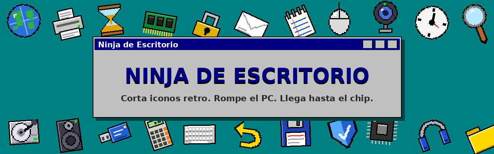
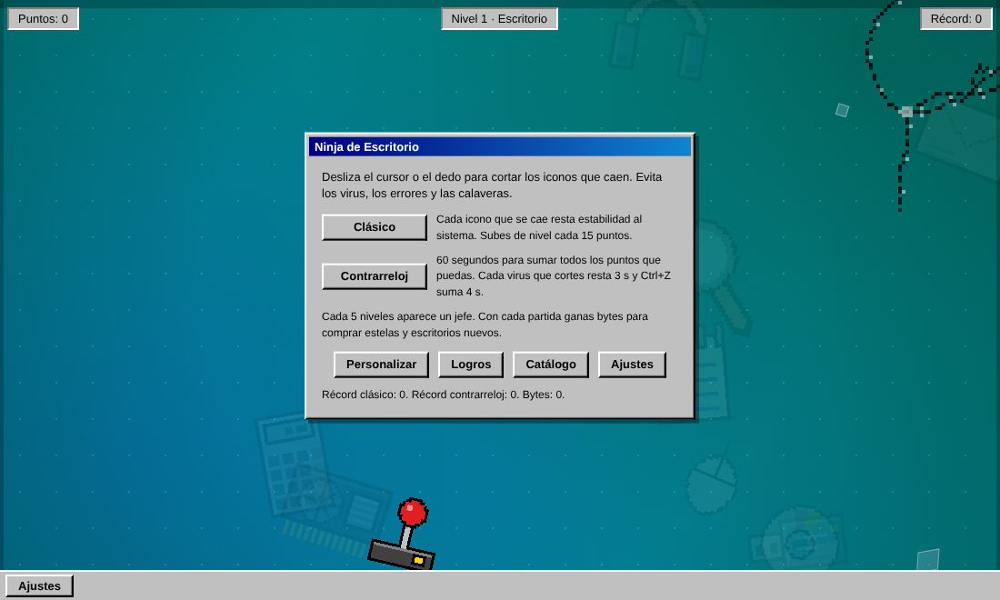
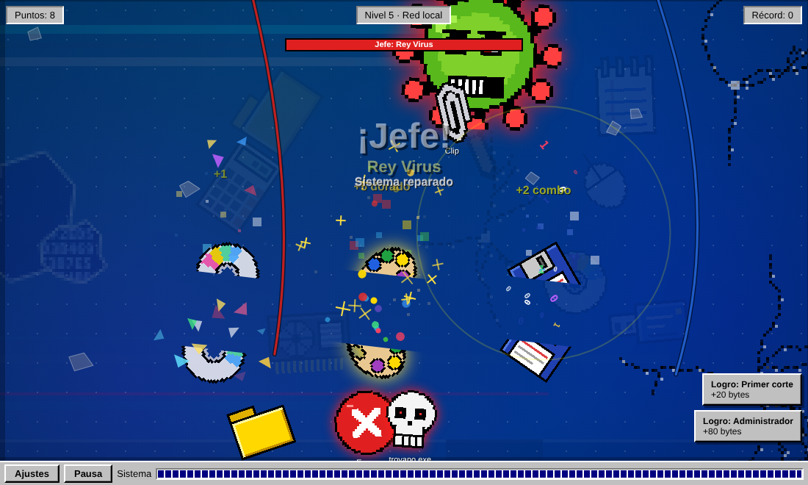
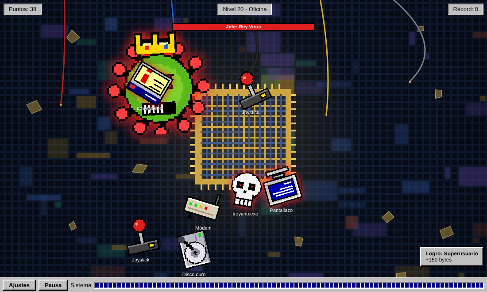
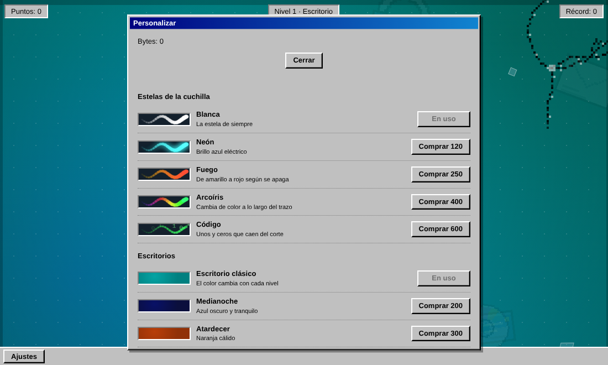
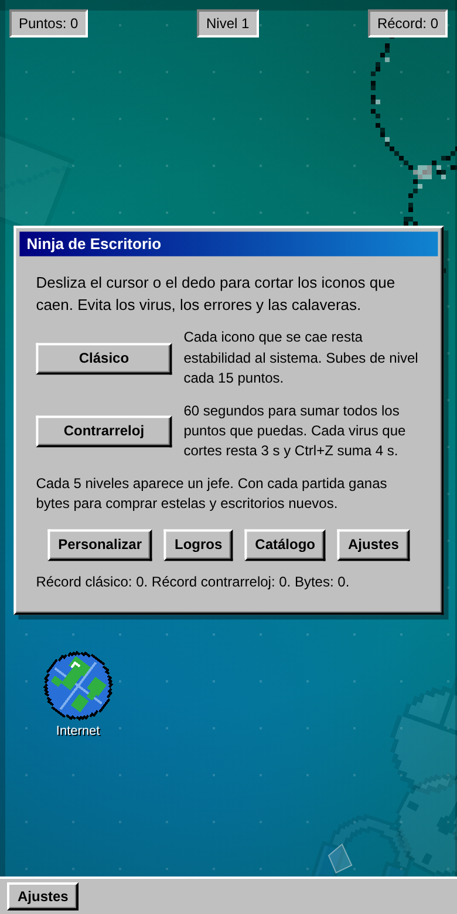
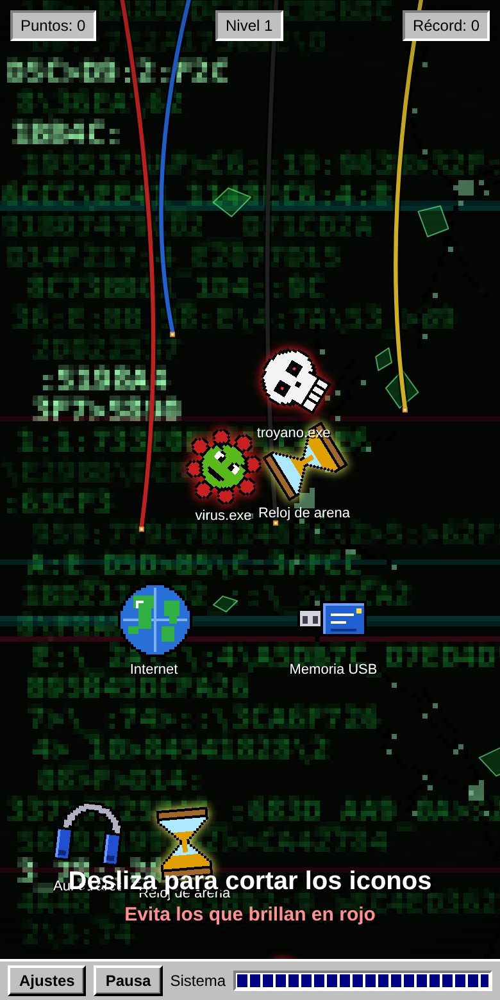
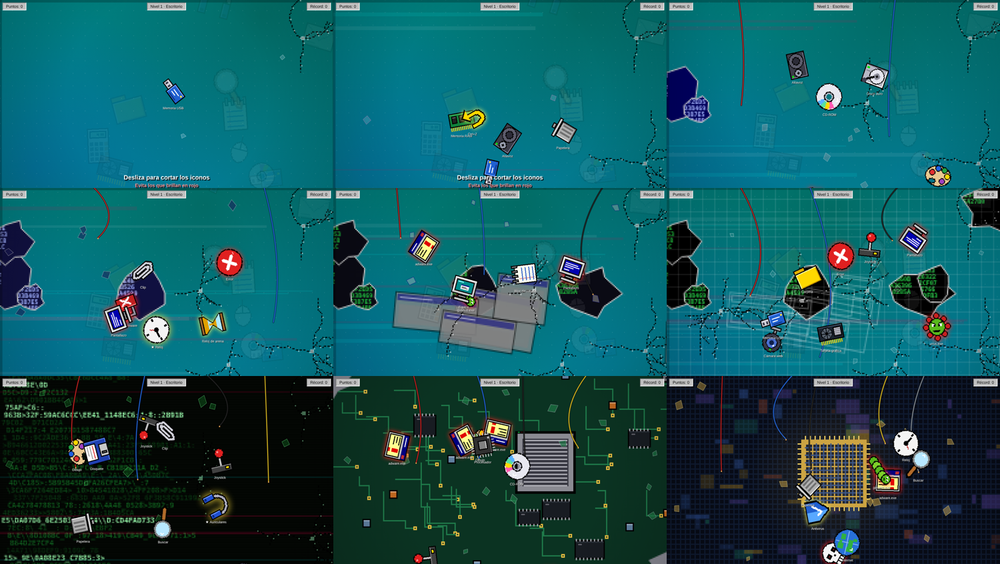
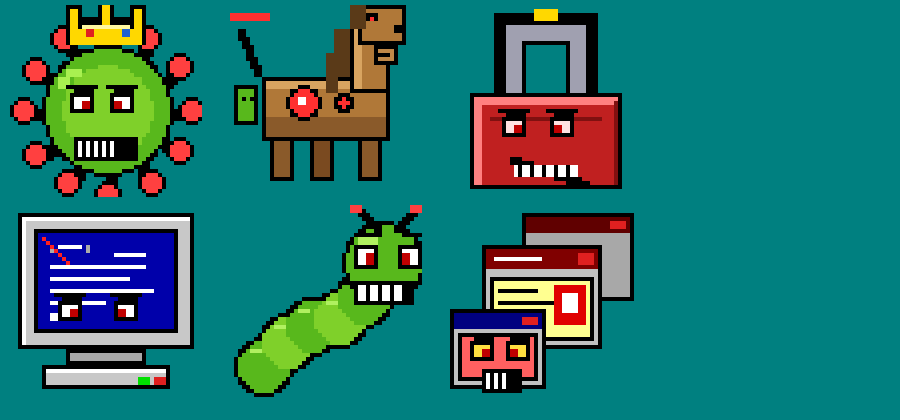
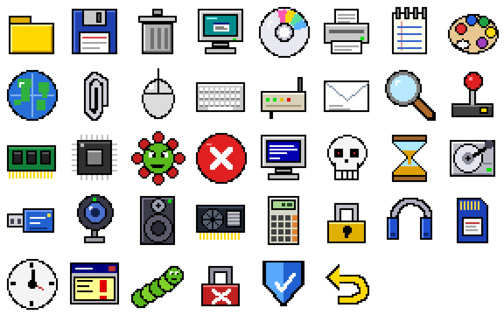

<div align="center">



# 🗡️ Ninja de Escritorio

**Un Fruit Ninja con iconos de ordenador retro.**
Corta carpetas, disquetes y CD-ROM, esquiva virus y pantallazos azules, derrota jefes de malware y rompe el PC capa a capa hasta llegar al chip.

[](https://ivanchux.github.io/ninja-de-escritorio/)


</div>

---

## 📑 Índice

[Qué es](#-qué-es) · [Capturas](#-capturas) · [Cómo se juega](#-cómo-se-juega) · [El PC que se rompe](#-el-pc-que-se-rompe) · [Efectos y power-ups](#-efectos-y-power-ups) · [Jefes](#-jefes) · [Tienda y logros](#-tienda-y-logros) · [Los 38 iconos](#-los-38-iconos) · [Ejecutar y publicar](#-ejecutar-y-publicar) · [Detalles técnicos](#-detalles-técnicos) · [Estructura](#-estructura-del-repositorio) · [Licencia](#-licencia)

## 🖥️ Qué es

Ninja de Escritorio es un juego de navegador en el que los objetos que vuelan son **iconos de los viejos sistemas operativos**: carpetas, papeleras, disquetes, módems, ratones de bola… y los enemigos son virus, errores y troyanos.

- Todo el arte está **dibujado a mano en píxeles** y generado por código. No hay logos reales ni imágenes externas.
- Interfaz inspirada en **Windows 95/98**: ventanas, botones biselados, barra de tareas y pantallazo azul de derrota.
- **Un solo archivo** (`index.html`), sin librerías, sin instalación y sin servidor.
- Funciona con **ratón y con pantalla táctil**.

## 📸 Capturas

<div align="center">

| Menú | Cortando iconos |
|:---:|:---:|
|  |  |

| Jefe final | Personalizar |
|:---:|:---:|
|  |  |

 &nbsp; 

*En el móvil se juega con el dedo y la interfaz se adapta a la pantalla.*

</div>

## 🎮 Cómo se juega

Desliza el ratón o el dedo para **cortar los iconos** que saltan por la pantalla.

| Tipo | Qué hacer |
|---|---|
| 🟢 Iconos normales | Córtalos. Suman puntos y se encadenan en combos. |
| ⭐ Iconos dorados | Brillan en amarillo y valen +4 puntos. |
| 🔴 Virus, errores y malware | No los cortes. Brillan en rojo y te penalizan. |
| 🔵 Power-ups | Cortarlos activa un efecto especial (ver más abajo). |

### Modos

- **Clásico:** tienes una barra de **estabilidad**. Cada icono bueno que se cae resta un 10 %. Cortar un virus resta un 30 %. Subir de nivel recupera un 20 %. Si llega a 0 aparece el pantallazo azul.
- **Contrarreloj:** 60 segundos. Cada virus resta 3 s y Ctrl+Z suma 4 s.

Subes de nivel cada **15 puntos** y la dificultad crece con cada nivel. Cada **5 niveles** aparece un jefe.

**Teclas (PC):** `P` o `Esc` para pausar.

## 💥 El PC que se rompe

El fondo es el interior de un ordenador y **se va destruyendo según avanzas**. Cada dos niveles cambias de capa, con un temblor de pantalla y un aviso. Cada capa añade más cables sueltos, chispas y piezas que caen.

<div align="center">

</div>

| # | Capa | Qué verás |
|:-:|---|---|
| 1 | **Pantalla** | Grietas en el cristal |
| 2 | **Software** | Más grietas y rayas de glitch |
| 3 | **Escritorio** | Agujeros en el escritorio con datos por debajo |
| 4 | **Sistema operativo** | Ventanas rotas y barra de tareas dañada |
| 5 | **Programas** | Ventanas del sistema desmoronándose |
| 6 | **Interfaz** | La interfaz queda en alambre y cuadrícula |
| 7 | **Consola** | Código verde sobre negro con ruido |
| 8 | **Hardware** | Placa base, condensadores, tornillos, cables cortados y chispas |
| 9 | **Chip** | El procesador al descubierto, con su brillo dorado |

El movimiento del fondo es lento a propósito. Si tu sistema pide *reducir movimiento*, se ralentiza todavía más. La pantalla de derrota es plana y no se mueve.

## ✨ Efectos y power-ups

Cada corte tiene **reacción visual**:

- **Estela de corte** que cruza el icono y dos mitades que salen disparadas.
- **Partículas propias de cada icono.** Los disquetes sueltan unos y ceros, los CD cristales de colores, el papel de la carpeta se esparce y los auriculares y altavoces sueltan notas musicales.
- **Manchas de píxeles** que quedan un momento en el fondo, como el jugo en Fruit Ninja.
- **Ondas** que crecen con el combo y un destello cada 5 de racha.
- **Micro-pausa** al cortar un dorado, un power-up o un jefe.
- **Glitch de pantalla** si cortas un virus.
- Tu **estela comprada** también tiñe las partículas.

| Power-up | Icono | Efecto |
|---|:-:|---|
| **Tiempo lento** | ⏳ | La pantalla se tiñe de azul y todo va a cámara lenta 4 s, con cuenta atrás visible. |
| **Antivirus** | 🛡️ | Un rayo azul sale hacia cada virus de la pantalla y los elimina. |
| **Ctrl+Z** | ↩️ | Rebobinado amarillo. Recupera un 25 % de estabilidad o suma 4 s. |

## 👾 Jefes

Cada 5 niveles aparece un jefe con **sprite propio de 48×48** que lanza iconos peligrosos. Hay que golpearlo varias veces antes de que escape. Si se va, pierdes estabilidad.

<div align="center">

</div>

**Rey Virus · Caballo de Troya · Ransomware · Pantallazo Gigante · Gusano Mayor · Adware Infinito**

## 🛒 Tienda y logros

Cada partida te da **bytes** para comprar:

- **Estelas:** Blanca, Neón, Fuego, Arcoíris y Código.
- **Escritorios:** Clásico (cambia de color con cada nivel), Medianoche, Atardecer, Algodón y Matriz.

Hay **14 logros** (Primer corte, Racha, Cazador de oro, Cazavirus, Superusuario…) y una tabla con tus mejores partidas.

Además hay música chiptune generada con Web Audio (más tensa en los jefes), efectos de sonido, vibración en móvil y un menú de ajustes para desactivarlos.

> El progreso se guarda en el `localStorage` del navegador. Es independiente en cada navegador y dispositivo.

## 🗂️ Los 38 iconos

Todos son originales, inspirados en el estilo de los sistemas operativos de los 90. Están en [`assets/iconos`](assets/iconos) en PNG de 256 px y se ven también dentro del juego, en **Catálogo**.

<div align="center">

</div>

**28 buenos** (carpeta, disquete, papelera, equipo, CD-ROM, impresora, bloc de notas, paleta, internet, clip, ratón, teclado, módem, correo, lupa, joystick, RAM, procesador, disco duro, USB, webcam, altavoz, tarjeta gráfica, calculadora, candado, auriculares, SD, reloj), **7 malos** (virus, error, pantallazo, troyano, adware, gusano, ransomware) y **3 power-ups** (reloj de arena, antivirus, Ctrl+Z).

## 🚀 Ejecutar y publicar

### Jugar en local

No hace falta instalar nada. Abre `index.html` en el navegador.

```bash
git clone https://github.com/Ivanchux/ninja-de-escritorio.git
cd ninja-de-escritorio
# abre index.html, o sirve la carpeta si prefieres:
python3 -m http.server 8000   # http://localhost:8000
```

### Publicar en GitHub Pages

1. Sube el repositorio a GitHub.
2. Ve a **Settings → Pages**.
3. En *Build and deployment* elige **Deploy from a branch**, rama `main` y carpeta `/ (root)`.
4. En un minuto estará en `https://ivanchux.github.io/ninja-de-escritorio/`.

## 🔧 Detalles técnicos

- **Canvas 2D** con bucle `requestAnimationFrame` y escalado por densidad de píxeles.
- **Pixel art procedural:** cada icono se dibuja por código en un lienzo de 32×32 (los jefes en 48×48) y se escala sin suavizado.
- **Entrada unificada** con *pointer events*, válida para ratón, táctil y lápiz. El corte es una intersección segmento-círculo.
- **Fondo por capas:** 9 escenas generadas por código con semilla fija, pintadas a baja resolución y escaladas sin suavizar. Es ligero en móviles.
- **Audio:** Web Audio API (osciladores), sin archivos de sonido.
- **Cursor de espada** pixel-art generado en tiempo de ejecución, solo con ratón.
- **Accesibilidad:** respeta `prefers-reduced-motion` y el modo oscuro del sistema; botones con foco visible.
- **Móvil:** `viewport-fit=cover`, márgenes de seguridad, `touch-action` controlado y partículas reducidas en pantallas pequeñas.
- **Cero dependencias**, sin peticiones de red.

## 📁 Estructura del repositorio

```text
ninja-de-escritorio/
├── index.html        # El juego completo (HTML + CSS + JS)
├── assets/iconos/    # Los 38 iconos en PNG
├── docs/             # Capturas e imágenes de este README
├── CHANGELOG.md      # Historial de versiones
├── LICENSE           # MIT
└── README.md
```

## 🗺️ Ideas futuras

- [ ] Jefe final propio para la capa del chip
- [ ] Ranking online
- [ ] Tutorial interactivo para móvil
- [ ] Más escritorios y estelas

## 📜 Licencia

El código y el arte están publicados bajo la licencia **[MIT](LICENSE)**. Puedes usarlos, modificarlos y compartirlos, manteniendo el aviso de copyright.

Los iconos son dibujos originales **inspirados** en el estilo de los sistemas operativos clásicos. No contienen logos, marcas ni recursos de ninguna compañía. *Windows* es una marca de Microsoft y este proyecto no está afiliado a ella.

---

<div align="center">

Hecho con 💾 por **[Ivanchux](https://github.com/Ivanchux)**

⭐ Si te ha gustado, deja una estrella al repositorio.

</div>
